  

  

## About

  

## GitHub Stats

  

  

---

## Recent Activity

<!--START_SECTION:activity-->
<!--END_SECTION:activity-->

---

## Contact

Have an idea, found a bug, or want to talk code? Reach out through GitHub or Discord.

---

> Code that works is good. Code that works well is better.
